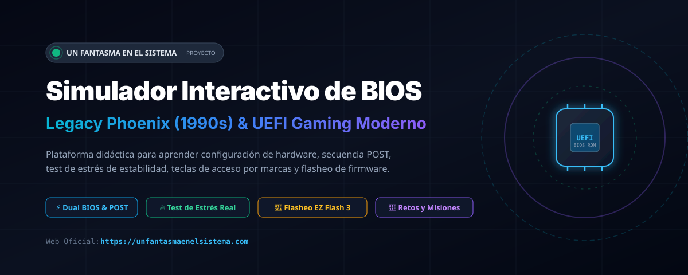
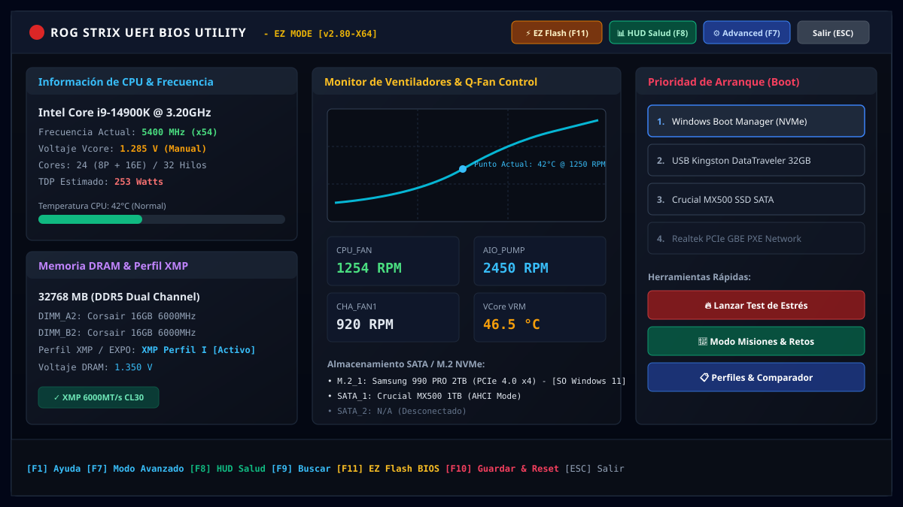
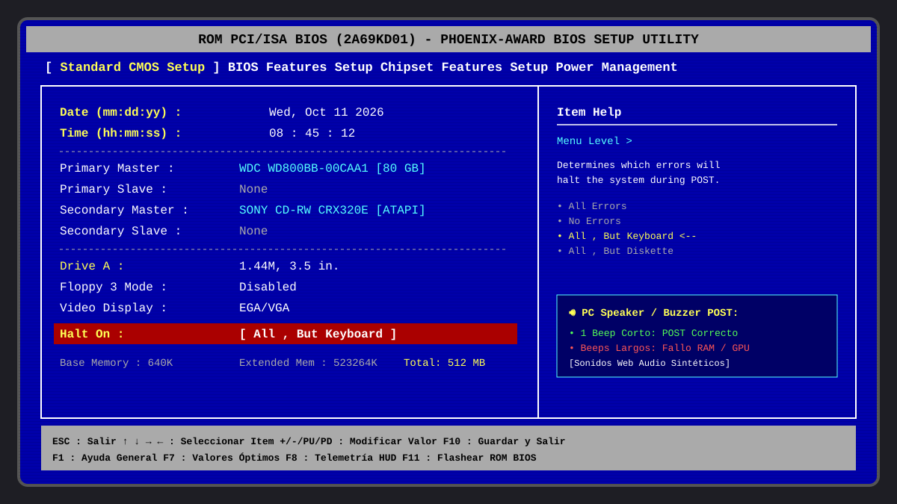
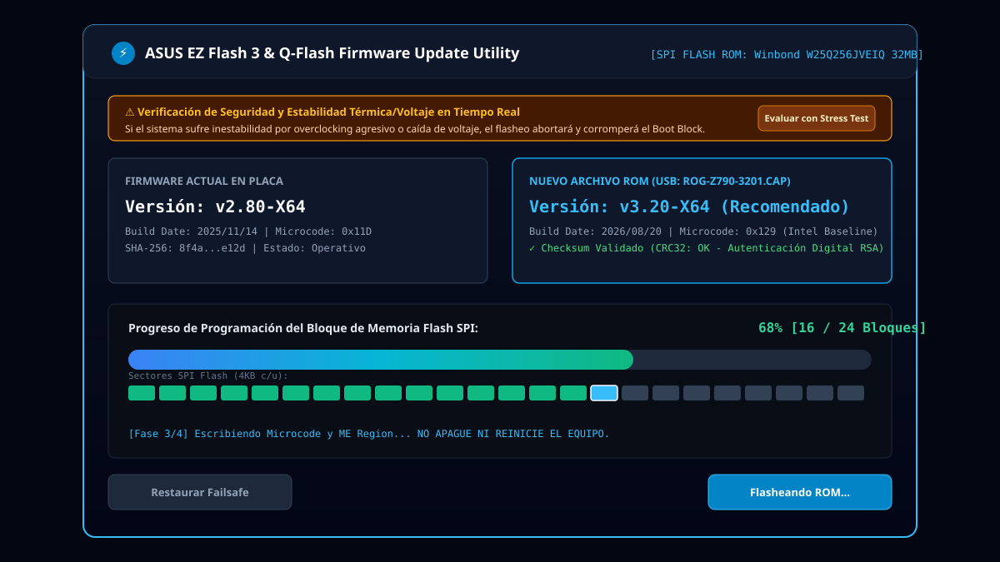
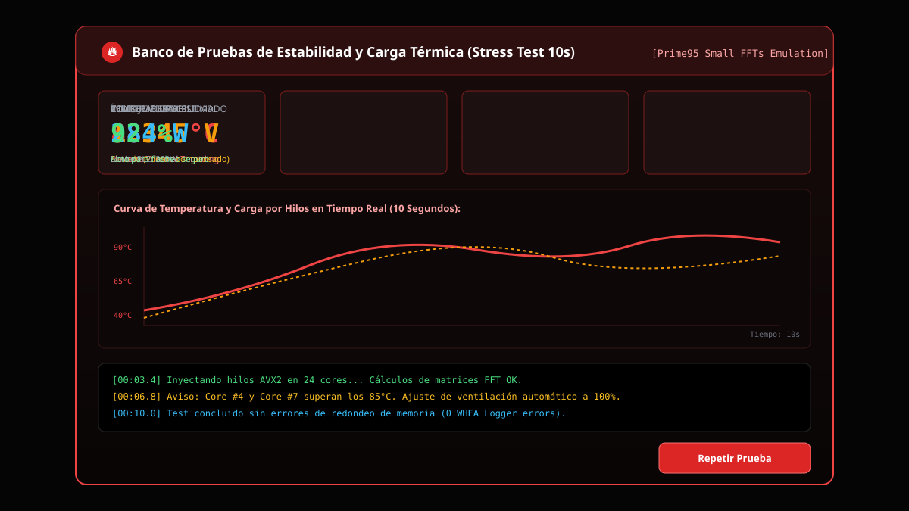
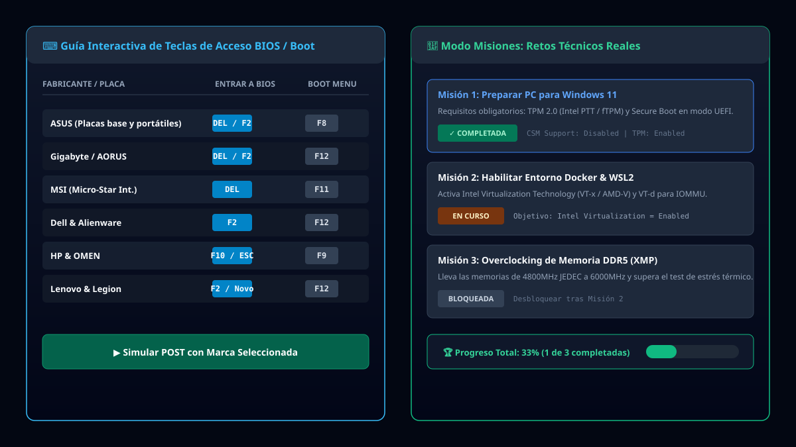

# 🖥️ Simulador Interactivo de BIOS Educativo

<div align="center">



[](https://react.dev/)
[](https://www.typescriptlang.org/)
[](https://vitejs.dev/)
[](https://tailwindcss.com/)
[](LICENSE)
[](https://unfantasmaenelsistema.com)

**Una plataforma interactiva y didáctica de código abierto para aprender el funcionamiento interno de la BIOS/UEFI, la secuencia POST, diagnóstico de hardware, estabilidad térmica y flasheo seguro de firmware.**

[🌐 Sitio Web Oficial](https://unfantasmaenelsistema.com) • [✨ Características](#-características-principales) • [📸 Capturas](#-capturas-de-pantalla) • [🚀 Instalación](#-instalación-y-despliegue) • [🎮 Controles](#-atajos-de-teclado-y-controles) • [📂 Estructura](#-estructura-del-proyecto)

</div>

---

## 📖 Acerca del Proyecto

En el aprendizaje de informática, montaje de ordenadores y soporte técnico de sistemas, la **BIOS (Basic Input/Output System)** y su evolución **UEFI (Unified Extensible Firmware Interface)** son componentes críticos y a menudo intimidantes. Configurar voltajes incorrectos, deshabilitar la virtualización o flashear una ROM inestable en un equipo físico puede provocar bloqueos (cuelgues) o incluso dejar la placa base inservible (*bricking*).

Este **Simulador Educativo** fue desarrollado para ofrecer un entorno de laboratorio 100% seguro y realista en el navegador web. Permite experimentar sin riesgo con parámetros de hardware, observar el impacto de los cambios en tiempo real, entrenar la resolución de retos técnicos reales y simular el flasheo de firmware con consecuencias lógicas de estabilidad.

---

## ✨ Características Principales

### 1. ⚡ Entorno Dual: Clásico y Moderno
* **BIOS Clásica Legacy (Phoenix/Award de los años 90-2000)**:
  * Auténtica interfaz azul monocromática con bordes ASCII dobles.
  * Navegación exclusiva por teclado (flechas, `+`, `-`, `Enter`, `ESC`).
  * Opciones retro: Standard CMOS, detección de discos IDE Master/Slave, disqueteras de 1.44MB, Plug and Play OS, y configuración de puertos serie/paralelo.
* **UEFI Gaming Moderna (Estilo ASUS ROG / AORUS)**:
  * Interfaz gráfica oscura con aceleración visual e iconos interactivos.
  * **Modo EZ (Easy Mode)** con medidores circulares de frecuencia, perfiles XMP/EXPO, panel de ventiladores Q-Fan y lista de discos de arranque arrastrables.
  * **Modo Avanzado (F7)** organizado en pestañas jerárquicas (*Ai Tweaker, Advanced, Monitor, Boot, Tool*).

---

### 2. 🔄 Utilidad de Flasheo de Firmware (ASUS EZ Flash 3 / Q-Flash)
* **Simulación completa de actualización de ROM**:
  * Detección del chip SPI Flash (`Winbond W25Q256JVEIQ 32MB`).
  * Validación criptográfica del archivo de actualización (comprobación de integridad SHA-256 / CRC32).
  * Comparador de versión actual (`v2.80-X64`) frente a la nueva versión (`v3.20-X64 CAP`).
  * Simulación visual del borrado y programación de los 24 bloques de memoria flash en tiempo real con pulsos acústicos.
* **Integración con Parámetros de Estabilidad del Stress Test**:
  * Si el usuario ha configurado un overclock inestable, voltajes excesivos o refrigeración deficiente que suspenden el test de estrés térmico, **el proceso de flasheo falla intencionalmente**, corrompiendo el sector de arranque y simulando un *brick* de la placa.
  * Incluye módulo pedagógico que explica por qué **nunca se debe actualizar la BIOS con perfiles inestables** y guía paso a paso los métodos de recuperación física (*USB BIOS Flashback*, *Clear CMOS* y *Dual BIOS*).

---

### 3. 🧪 Banco de Pruebas Térmico y de Estabilidad (Stress Test 10s)
* Simula una carga de cálculo intensivo (tipo *Prime95 Small FFTs* con instrucciones AVX2) durante 10 segundos.
* Telemetría dinámica que evalúa:
  * Curva de temperatura de los núcleos de la CPU (°C).
  * Consumo energético en tiempo real (Watts) y límites PL1/PL2.
  * Estabilidad del voltaje Vcore y caída bajo carga (*Vdroop*).
  * Cálculo probabilístico de riesgo de cuelgue (BSOD), errores de memoria o *thermal throttling*.

---

### 4. ⚡ Secuencia de Arranque POST y Buzzer Realista
* Emulación fiel del encendido del PC en pantalla negra:
  * Conteo y testeo de memoria RAM.
  * Inicialización de controladores de almacenamiento SATA y NVMe.
  * **Sonido real de altavoz de placa base (PC Speaker)**: Generado matemáticamente mediante la **Web Audio API** sin archivos de audio externos (pitido único de POST correcto, o secuencias de beeps de error si la configuración falla).
  * Ventana de tiempo interactiva para pulsar la tecla de acceso a la BIOS antes de que cargue el sistema operativo.

---

### 5. ⌨️ Guía Interactiva de Teclas por Fabricante
* Directorio exhaustivo con las teclas de acceso a **BIOS** y **Boot Menu** de más de 20 marcas de equipos y placas base:
  * **ASUS**, **Gigabyte / AORUS**, **MSI**, **ASRock**, **Dell / Alienware**, **HP / OMEN**, **Lenovo / ThinkPad**, **Acer**, **Apple**, **Toshiba**, etc.
  * Filtro de búsqueda instantánea por fabricante o tipo de dispositivo.
  * Botón para lanzar la secuencia POST directamente simulando la marca elegida.

---

### 6. 🎯 Modo Misiones y Retos Técnicos Educativos
* Retos guiados paso a paso con validación automática del estado de la configuración:
  * **Preparar el equipo para Windows 11**: Habilitar Intel PTT / AMD fTPM (TPM 2.0), activar Secure Boot y desactivar CSM Legacy.
  * **Habilitar Entorno de Virtualización para Docker y WSL2**: Activar Intel VT-x / AMD-V y la tecnología IOMMU (VT-d / AMD Vi).
  * **Optimización de Memoria RAM (XMP / EXPO)**: Activar perfil de altas frecuencias manteniendo voltajes seguros.
  * **Perfil Servidor Doméstico Ultra-Silencioso**: Optimizar curvas de ventilador y estados de ahorro C-States.
  * **Solucionar Bucle de Arranque (Boot Loop)**: Diagnosticar discos no detectados y restaurar orden de prioridad UEFI.

---

### 7. 📊 Monitor HUD de Diagnóstico de Hardware en Tiempo Real (F8)
* Accesible en cualquier momento mediante la tecla **F8**.
* Muestra en una superposición flotante translúcida:
  * Frecuencia efectiva de la CPU (Multiplicador x BCLK).
  * Voltaje Vcore y temperatura de unión (*Tjunction*).
  * Velocidad y latencias CAS de la memoria DRAM.
  * Consumo estimado en vatios (TDP) según la carga configurada.
  * Estado de las tecnologías clave (TPM 2.0, Secure Boot, VT-x, Re-Size BAR).

---

### 8. 📋 Gestor de Perfiles y Comparador Visual
* Permite guardar y exportar configuraciones personalizadas en el navegador (`LocalStorage`).
* Perfiles preconfigurados incluidos:
  * **Valores Óptimos de Fábrica (Default / Failsafe)**.
  * **Perfil Gaming con Overclocking Moderado**.
  * **Perfil Eco Ahorro Energético de Oficina**.
  * **Perfil Laboratorio de Virtualización**.
* Comparador visual con indicación diferencial (*diff*) de las opciones modificadas.

---

## 📸 Capturas de Pantalla

### 🖥️ Interfaz UEFI Gaming Moderna (Modo EZ & Advanced)


---

### 🕹️ Interfaz BIOS Legacy Clásica (Phoenix/Award años 90)


---

### 🔄 Utilidad de Flasheo de Firmware (ASUS EZ Flash 3)


---

### 🔥 Banco de Pruebas y Test de Estrés Térmico (10s)


---

### ⌨️ Guía de Teclas por Marcas y Modo Misiones Educativas


---

## 🎮 Atajos de Teclado y Controles

| Tecla / Atajo | Acción en el Simulador | Contexto |
| :--- | :--- | :--- |
| `DEL` / `F2` | Entrar a la BIOS durante el POST | Secuencia de arranque |
| `F8` | Abrir / Cerrar HUD de Diagnóstico y Salud | Pantalla de BIOS |
| `F7` | Alternar entre Modo EZ y Modo Avanzado | BIOS UEFI Moderna |
| `F11` | Abrir Utilidad de Flasheo de BIOS (EZ Flash) | Global en BIOS y Launcher |
| `F9` | Búsqueda rápida de opciones de configuración | BIOS UEFI Moderna |
| `F10` | Guardar cambios y reiniciar equipo (Save & Exit) | Cualquier pantalla BIOS |
| `F5` / `F7` | Restaurar valores por defecto seguros (Failsafe) | Cualquier pantalla BIOS |
| `ESC` | Salir del submenú actual o volver al Launcher | Global |
| `↑` / `↓` | Navegar entre las opciones del menú | Menú BIOS |
| `←` / `→` | Cambiar de pestaña / categoría principal | Menú BIOS |
| `Enter` | Seleccionar opción o confirmar diálogo | Menú BIOS |
| `+` / `-` | Incrementar o decrementar el valor del parámetro | Edición de valores |

---

## 🚀 Instalación y Despliegue

### Requisitos Previos
* **Node.js** v18.0.0 o superior
* **npm**, **pnpm** o **yarn**

### Pasos para Ejecutar en Local

1. **Clonar el repositorio**:
   ```bash
   git clone https://github.com/unfantasmaenelsistema/bios-simulator.git
   cd bios-simulator
   ```

2. **Instalar dependencias**:
   ```bash
   npm install
   ```

3. **Iniciar el servidor de desarrollo**:
   ```bash
   npm run dev
   ```
   Abre tu navegador en `http://localhost:3000` para comenzar a interactuar con el simulador.

4. **Compilar para producción**:
   ```bash
   npm run build
   ```
   Los archivos estáticos optimizados se generarán en la carpeta `dist/`.

5. **Previsualizar la compilación de producción**:
   ```bash
   npm run preview
   ```

---

## 📂 Estructura del Proyecto

```text
bios-simulator/
├── docs/
│   └── screenshots/               # Capturas vectoriales de alta fidelidad para el README
│       ├── banner-header.svg
│       ├── modern-uefi-bios.svg
│       ├── legacy-phoenix-bios.svg
│       ├── bios-update-ezflash.svg
│       ├── stress-test-diagnostics.svg
│       └── missions-brand-keys.svg
├── public/
│   ├── icono.png                  # Favicon e icono de la aplicación
│   └── unfantasmaenelsistema-text.png # Logotipo oficial del autor
├── src/
│   ├── components/
│   │   ├── BiosLauncher.tsx       # Menú principal y selector de modos
│   │   ├── ModernUefiBios.tsx     # Simulador de UEFI ROG Gaming (EZ & Advanced)
│   │   ├── LegacyBios.tsx         # Simulador de BIOS Phoenix/Award retro (1990s)
│   │   ├── PostScreen.tsx         # Secuencia de encendido POST y detección de RAM/discos
│   │   ├── BiosUpdateModal.tsx    # Utilidad de flasheo de firmware EZ Flash 3
│   │   ├── StressTestModal.tsx    # Banco de pruebas térmicas y test de estabilidad (10s)
│   │   ├── DiagnosticOverlay.tsx  # HUD flotante de telemetría de hardware (F8)
│   │   ├── BootPriorityManager.tsx# Gestor interactivo de orden de arranque
│   │   ├── BrandKeysModal.tsx     # Guía de teclas de acceso BIOS/Boot por marca
│   │   ├── ProfileComparator.tsx  # Gestor y comparador de perfiles de configuración
│   │   ├── MissionsModal.tsx      # Retos técnicos con validación pedagógica
│   │   └── SaveExitDialog.tsx     # Diálogo de confirmación de guardado y reinicio
│   ├── data/
│   │   ├── biosOptions.ts         # Catálogo exhaustivo de opciones de BIOS categorizadas
│   │   ├── brandKeys.ts           # Base de datos de teclas por fabricante de hardware
│   │   └── missions.ts            # Definición de misiones y criterios de validación
│   ├── types/
│   │   └── bios.ts                # Modelos y contratos de TypeScript
│   ├── utils/
│   │   ├── audio.ts               # Sintetizador Web Audio API (PC Speaker y teclas)
│   │   └── stressTestSimulator.ts # Motor matemático de cálculo térmico y estabilidad
│   ├── App.tsx                    # Orquestador principal del estado de la aplicación
│   ├── index.css                  # Estilos globales y Tailwind CSS
│   └── main.tsx                   # Punto de entrada de React
├── index.html                     # Documento HTML con metadatos SEO y favicon
├── metadata.json                  # Metadatos del entorno AI Studio
├── package.json                   # Definición de paquetes y scripts
├── tsconfig.json                  # Configuración del compilador TypeScript
└── vite.config.ts                 # Configuración del empaquetador Vite
```

---

## 🛠️ Tecnologías Utilizadas

* **[React 19](https://react.dev/)**: Componentes funcionales y arquitectura basada en hooks para gestión de estado reactivo.
* **[TypeScript](https://www.typescriptlang.org/)**: Tipado estático riguroso para las opciones de hardware, estados y perfiles.
* **[Vite](https://vitejs.dev/)**: Entorno de desarrollo ultrarrápido y empaquetador para producción.
* **[Tailwind CSS v4](https://tailwindcss.com/)**: Estilizado declarativo con temas oscuros de alta fidelidad y fidelidad visual retro.
* **[Lucide React](https://lucide.dev/)**: Iconografía moderna y limpia para herramientas, ventiladores y componentes de hardware.
* **[Canvas Confetti](https://github.com/catdad/canvas-confetti)**: Animaciones de celebración al completar con éxito los retos técnicos.
* **Web Audio API**: Síntesis de sonido nativa en tiempo real para simular los tonos del zumbador interno del PC (beeps de 800Hz y 1000Hz).

---

## 📜 Licencia

Distribuido bajo la Licencia **MIT**. Consulta el archivo `LICENSE` para más información.

---

## 👤 Autor y Agradecimientos

Desarrollado con dedicación por **[Un Fantasma en el Sistema](https://unfantasmaenelsistema.com)**.

* 🌐 **Sitio Web Oficial**: [unfantasmaenelsistema.com](https://unfantasmaenelsistema.com)
* 💡 **Propósito**: Proyecto educativo dedicado a la divulgación de informática, hardware, seguridad y sistemas operativos.

Si este proyecto te ha resultado útil para aprender o enseñar conceptos de BIOS y hardware, ¡no dudes en darle una ⭐ en GitHub!
